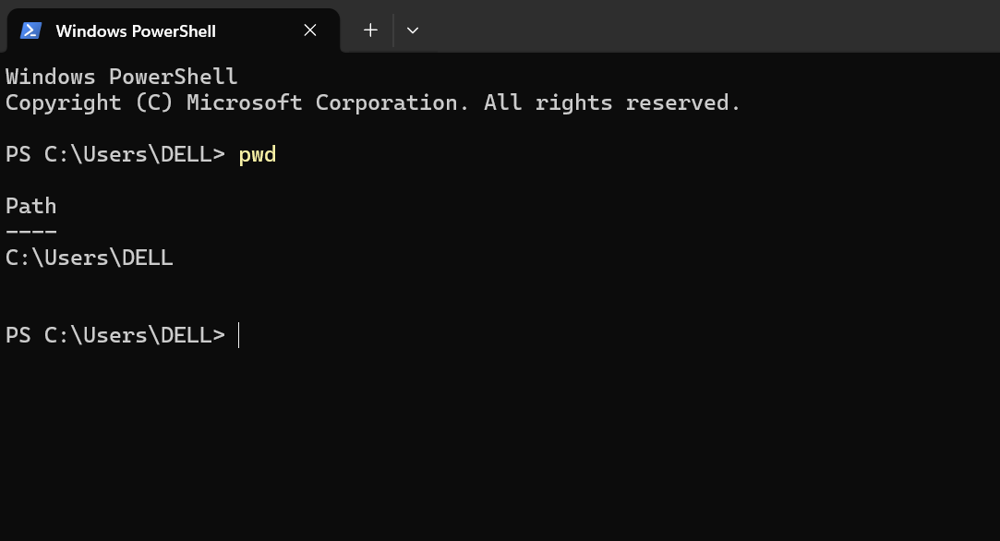
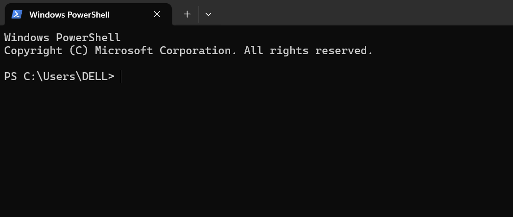
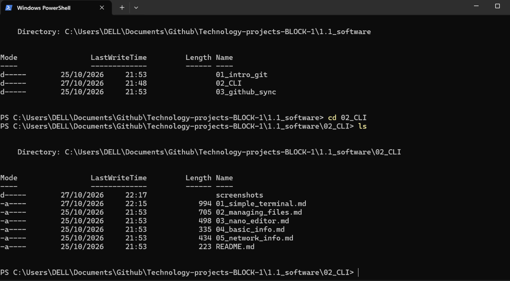
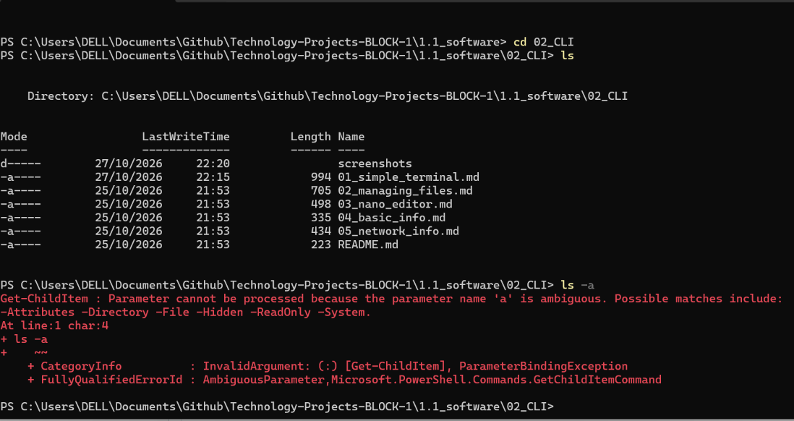
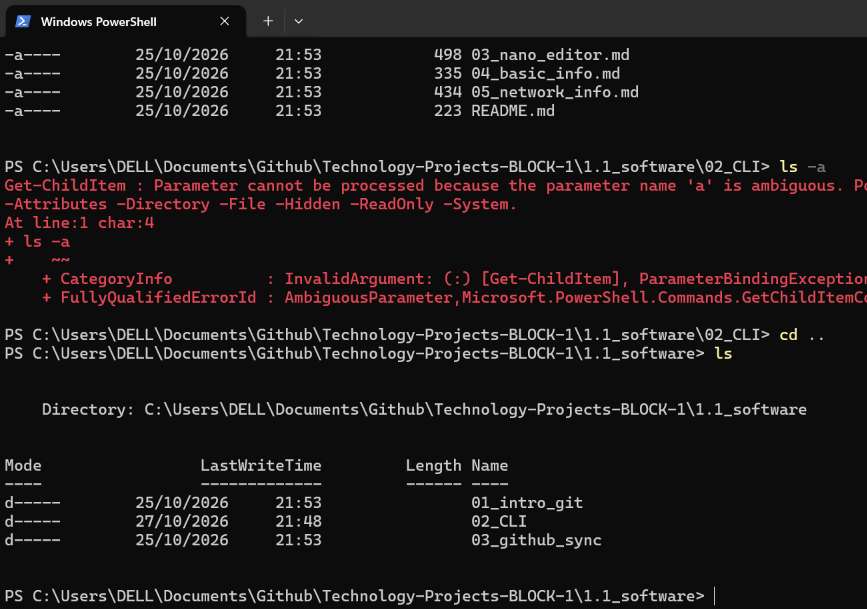

## ⭐ Activity 1: Finding Your Way Around

### 🎯 Goal  
Learn how to check where you are and explore folders.

### 📝 Tasks
1. Open the Terminal.  
2. Type `pwd` and write down the output.  
3. List all files in your current folder using `ls`.  
4. Move into your CLI assignment folder for Week 02:
   ```bash
   cd Documents
   cd Technology_Projects
   cd Week 02
   cd CLI
   ```
5. Inside that folder, list all files (including hidden ones):
   ```bash
   ls -a
   ```
6. Go back to your home directory:
   ```bash
   cd ~
   ```

**Submit a screenshot of every step to the images folder**
`images/CLI_step1.jpg`

`images/CLI_step2.jpg`

`images/CLI_step3.jpg`

`images/CLI_step4.jpg`

`images/CLI_step5.jpg`

`images/CLI_step6.jpg`

